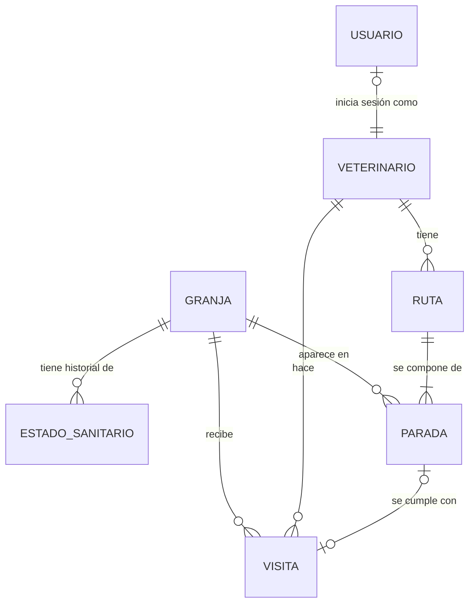

# Modelo de dominio de BioRuta (borrador v0)

Borrador para la sesión del día 1 con Otto. Es el punto de partida para escribir `openapi.json` y los modelos SQLModel del día 2, así que todo se puede discutir. El contrato v0 que sale de aquí está en [openapi.json](openapi.json). Cada entidad y cada campo lleva al lado la razón por la que está; si no encontramos razón, el campo sobra.

Lo he hecho con tres criterios:

1. Solo entra lo que necesita alguna de las cuatro cosas que enseña la demo: comparar rutas, registrar una visita, simular un positivo y ver la trazabilidad. Si un dato no lo usa ninguna, se queda fuera aunque sea realista.
2. Los números del motor (sensibilidades, riesgos, horas de vacío) no van en la base de datos sino en `risk_config.yaml`, porque cada uno tiene que apuntar a una fila de `docs/reglas.md` con su fuente. Si estuvieran en la base de datos, cambiarlos no dejaría rastro en Git y no podríamos enseñar de dónde sale cada cifra.
3. Lo que se puede calcular no se guarda. El riesgo actual del veterinario, el estado sanitario vigente de una granja o la lista de expuestos tras un brote se calculan a partir de las visitas y del historial. Así no hay dos versiones del mismo dato que puedan contradecirse.

## Vista general

Hay cinco entidades de dominio (Granja, EstadoSanitario, Veterinario, Visita y Ruta con sus Paradas) y una técnica (Usuario). La hoja de reglas y la trazabilidad también forman parte del dominio, pero no son tablas; se explican al final.

## Granja

Es el centro de todo: el motor ordena granjas, las visitas se hacen en granjas y los brotes empiezan en una granja.

| Campo | Tipo | Por qué está |
|---|---|---|
| `id` | entero | Clave interna. No usamos el código REGA como clave porque en los datos del evento puede faltar o venir con otro formato, y no queremos que eso rompa las relaciones. |
| `codigo_rega` | texto, único, opcional | Es el identificador oficial de las explotaciones ganaderas en España. Si los datos del evento lo traen, el adaptador lo usa para no duplicar granjas al importar dos veces. Es opcional porque los datos simulados no lo necesitan. |
| `nombre` | texto | Lo que lee el veterinario en la lista y en el mapa. Un código no se entiende en una demo. |
| `tipo` | enum `TipoGranja` | Define la sensibilidad de la granja (cuánto se pierde si se contagia), que es la mitad de la función de coste. El valor de sensibilidad de cada tipo está en `risk_config.yaml`, no aquí. |
| `latitud`, `longitud` | decimales (WGS84) | Las necesitan el cálculo de distancias (Haversine) y el mapa. WGS84 porque es lo que usan Leaflet y OSRM y lo que suelen traer los datos abiertos. |
| `municipio`, `provincia` | texto | Para filtrar la lista y para que el jurado sitúe las granjas sin abrir el mapa. |
| `zona` | texto, opcional | Agrupación de granjas (comarca, integradora o «comunidad» de granjas muy conectadas). El plan pide filtrar por zona y la referencia de Machado Lab usa el paso entre comunidades como factor de riesgo. De momento solo sirve para filtrar; si una regla lo usa, tendrá su fila en la hoja. |

`TipoGranja` tiene estos valores, ordenados de más a menos sensible según la propuesta: `nucleo_genetico`, `multiplicacion`, `maternidad`, `ciclo_cerrado`, `transicion`, `cebo`. El orden y los valores numéricos están pendientes de fuente (fila «Sensibilidad por tipo de granja» de la hoja). Es un enum y no texto libre porque el motor necesita un valor de sensibilidad para cada tipo; si llega un tipo nuevo el día del evento, se añade al enum y a `risk_config.yaml` a la vez, y si alguien se olvida de lo segundo, falla un test en vez de calcular mal en silencio.

Lo que no he puesto, y por qué:

- Censo o número de animales. Ninguna pantalla ni regla lo usa. Si las fuentes dicen que el tamaño cambia el riesgo, se añade.
- Estado sanitario como campo de la granja. Va en su propia tabla con historial (siguiente apartado).
- Dueño, teléfono, integradora. No los usa la demo y son datos personales que no queremos ni simular.

## EstadoSanitario

Historial de estados de cada granja. Cada fila dice «desde tal fecha, esta granja está en tal estado por tal enfermedad».

| Campo | Tipo | Por qué está |
|---|---|---|
| `id` | entero | Clave interna. |
| `granja_id` | FK a Granja | De qué granja es el estado. |
| `estado` | enum `Estado` | Es el riesgo que emite la granja: lo que se lleva el veterinario al salir. |
| `enfermedad` | enum `Enfermedad`, opcional | PPA y PRRS no se tratan igual: la PPA es de declaración obligatoria y la PRRS está muy extendida. La enfermedad sale en la explicación de cada parada y puede cambiar la ventana de trazabilidad. Es nulo cuando el estado es `sin_incidencias`. |
| `desde` | fecha y hora | Cuándo empieza a valer el estado. La trazabilidad se calcula hacia atrás desde esta fecha. |
| `hasta` | fecha y hora, opcional | Cuándo deja de valer. Nulo mientras esté vigente. |
| `origen` | enum: `importado`, `alerta`, `seed` | Para distinguir en la demo y en los tests un estado que vino en los datos de uno que alguien marcó con «Simular positivo». También sirve para que «Reiniciar demo» borre solo las alertas. |

`Estado` tiene cuatro valores, de más a menos riesgo: `positiva`, `sospechosa`, `zona_vigilancia`, `sin_incidencias`. Cuánto riesgo emite cada uno está en `risk_config.yaml`.

`Enfermedad` empieza con `ppa`, `prrs` y `otra`. Son las dos que nombra la propuesta; `otra` está para que un dato importado con una enfermedad que no conocemos (PED, por ejemplo) no se pierda ni rompa el importador.

Por qué es una tabla con historial y no un campo `estado` en Granja:

- La trazabilidad necesita saber cuándo cambió el estado, no solo cuál es ahora. Si un positivo se confirma el día 10, hay que mirar quién pasó por la granja los días anteriores.
- El día 7 hay que «marcar una granja como positiva en una fecha». Eso es insertar una fila, no sobrescribir un campo, así que no se pierde el estado anterior y la demo se puede reiniciar.
- Una granja puede tener a la vez PRRS estable y una sospecha de PPA. Con historial, cada una es una fila vigente y el estado actual de la granja es el de mayor riesgo entre las filas vigentes. Esa regla también necesita su fila en la hoja (por ahora es un supuesto nuestro).

He metido `zona_vigilancia` como un estado más, y no como un campo booleano aparte, porque la propuesta ya la trata como un escalón de riesgo entre «sospechosa» y «sin incidencias». El inconveniente es que en la realidad una zona de vigilancia depende de un radio alrededor de un foco, y aquí la marcamos a mano o viene en los datos. Calcularla sola a partir de los focos sería más correcto, pero hace falta el radio con su fuente y no lo necesita ninguna pantalla. Lo dejo como mejora y lo apuntamos en «Supuestos y limitaciones».

No hay entidad Alerta. Una alerta es un EstadoSanitario nuevo con `origen = alerta`. Tenerlas por separado obligaría a mantener sincronizadas dos tablas que dicen lo mismo.

## Veterinario

| Campo | Tipo | Por qué está |
|---|---|---|
| `id` | entero | Clave interna. |
| `nombre` | texto | Para la barra superior, la trazabilidad («la visitó Laura el martes») y las rutas. |
| `base_latitud`, `base_longitud` | decimales | Es el punto de salida de la ruta. El endpoint de rutas lo pide y sin él la primera parada no tiene distancia. |

El riesgo con el que va el veterinario en cada momento no se guarda. Se calcula a partir de su última visita: el estado de esa granja, las horas que han pasado desde la salida y las medidas que aplicó. Si lo guardáramos, habría que actualizarlo en cada visita, en cada alerta y cada vez que cambiara una regla, y basta con olvidar uno de esos casos para enseñar un dato falso en la demo.

Dos veterinarios en el seed bastan para que la trazabilidad enseñe algo interesante (uno expuesto y otro no). No hay especialidades, horarios ni vehículos: ninguna regla los usa todavía.

## Visita

Lo que pasó de verdad: un veterinario entró en una granja y salió.

| Campo | Tipo | Por qué está |
|---|---|---|
| `id` | entero | Clave interna. |
| `veterinario_id` | FK a Veterinario | Quién fue. Es la mitad de la pregunta de la trazabilidad. |
| `granja_id` | FK a Granja | Dónde fue. |
| `entrada` | fecha y hora | Lo registra el botón «Entrar». Hace falta la hora y no solo el día porque el vacío sanitario se cuenta en horas. |
| `salida` | fecha y hora, opcional | Lo registra el botón «Salir». Nulo mientras la visita está abierta. El vacío sanitario empieza a contar desde aquí. |
| `medidas` | lista de enum `Medida` | Lo que hizo el veterinario al salir (ducha, cambio de ropa, desinfección de calzado). Cada medida reduce el riesgo que lleva encima según la hoja de reglas. Se marca al pulsar «Salir». |
| `parada_id` | FK a Parada, opcional | Une la visita con la parada planificada, para marcarla como hecha en la ruta del día. Es opcional porque una visita puede ser imprevista o venir importada sin ruta. |
| `estado_granja_en_visita` | enum `Estado` | Una copia del estado que tenía la granja al entrar. Es la única excepción al criterio de no guardar lo calculable, y la explico abajo. |

`Medida` empieza con `ducha`, `cambio_ropa` y `desinfeccion_calzado`. Cada una tiene su fila en la hoja; si no encontramos fuente para cuánto reduce el riesgo, queda como supuesto configurable.

Por qué `medidas` es una lista dentro de la visita y no una tabla aparte: siempre se leen y se escriben junto con la visita, no tienen datos propios y son pocas. En SQLite y PostgreSQL se guarda como JSON. Si un día una medida necesita hora o responsable, se pasa a tabla.

Por qué se copia el estado de la granja en la visita: si una granja era `sin_incidencias` el lunes y se marca positiva el miércoles con fecha del miércoles, la visita del lunes no debe aparecer de repente como «visita a una positiva». La copia deja la foto de lo que se sabía al entrar. La trazabilidad, en cambio, usa el historial, porque su pregunta es otra: no qué sabía el veterinario, sino quién pudo contagiarse.

Reglas que tiene que cumplir una visita (las comprueba el backend, no la interfaz):

- `salida` es posterior a `entrada`.
- Un veterinario no puede tener dos visitas abiertas a la vez. Si pulsa «Entrar» con una abierta, la API lo rechaza con un mensaje claro.
- Las fechas se guardan en UTC y se enseñan en hora de Madrid. Si no, el cálculo de horas de vacío falla dos veces al año con el cambio de hora.

## Ruta y Parada

Lo planificado: el orden en que el veterinario piensa visitar las granjas de un día.

Ruta:

| Campo | Tipo | Por qué está |
|---|---|---|
| `id` | entero | Clave interna. |
| `veterinario_id` | FK a Veterinario | De quién es la ruta. Su base es el punto de salida. |
| `fecha` | fecha | El día al que se refiere. Un veterinario tiene como mucho una ruta por día. |
| `criterio` | enum: `mas_corta`, `segura` | Qué ruta eligió el veterinario. El endpoint calcula las dos para compararlas, pero solo se guarda la elegida. |
| `km_total` | decimal | Para el panel comparativo y para el README («+X km a cambio de 0 exposiciones»). |
| `exposiciones` | entero | Número de transiciones peligrosas de la ruta. Es la otra cifra del panel. |
| `estado` | enum: `planificada`, `en_curso`, `cerrada`, `afectada_por_alerta` | Para que la pantalla de la ruta del día sepa qué enseñar y para marcar las rutas que hay que recalcular después de una alerta. |

Parada:

| Campo | Tipo | Por qué está |
|---|---|---|
| `id` | entero | Clave interna. |
| `ruta_id` | FK a Ruta | A qué ruta pertenece. |
| `orden` | entero | La posición en la ruta. Es lo que calcula el motor. |
| `granja_id` | FK a Granja | Qué granja toca. |
| `riesgo_llegada` | decimal | Con cuánto riesgo llega el veterinario a esta granja. Se enseña y sirve para pintar el tramo en rojo. |
| `explicacion` | texto | La frase que justifica la posición («Va primero: núcleo genético y llegas sin exposición previa»). |
| `regla_id` | texto, opcional | La fila de la hoja de reglas que decidió la posición (por ejemplo `R03`). La interfaz la usa para enlazar a `/fuentes`. Es nula si la posición la decidió solo la distancia. |

`km_total`, `exposiciones`, `riesgo_llegada` y `explicacion` también se podrían calcular. Los guardo porque son la salida del motor en un momento dado con unas reglas dadas. Si alguien cambia `risk_config.yaml`, la ruta de ayer tiene que seguir enseñando lo que se le dijo ayer al veterinario, no lo que diría hoy el motor.

Por qué guardar rutas y no solo calcularlas en el momento:

- El día 7, los botones «Entrar» y «Salir» viven en la ruta del día. Hace falta una ruta guardada a la que volver.
- La PWA tiene que enseñar la ruta sin cobertura, así que tiene que existir como dato descargable.
- «Recalcular rutas planificadas afectadas por una alerta» necesita saber qué rutas hay planificadas.

Si hay que recortar, Ruta y Parada son lo primero que se simplifica: el motor puede devolver el orden sin guardarlo y las visitas se registran sin `parada_id`. Se pierde el modo sin conexión y el recálculo tras la alerta, que ya están en la lista de recortes del plan.

## Usuario

| Campo | Tipo | Por qué está |
|---|---|---|
| `id` | entero | Clave interna. |
| `email` | texto, único | Para el formulario de login. |
| `password_hash` | texto | Contraseña con bcrypt. Nunca en claro. |
| `veterinario_id` | FK a Veterinario | Quién es en el dominio. Así la barra superior sabe de quién es el riesgo y qué ruta enseñar. |

Usuario y Veterinario van separados porque son cosas distintas: uno es una cuenta para entrar en la app y el otro es una persona que visita granjas. Se puede tener un veterinario sin cuenta, por ejemplo uno que viene en los datos importados y solo aparece en la trazabilidad. En la demo hay un único usuario, el que usa el botón «Entrar como demo». No hay roles.

## Lo que no es tabla

### Hoja de reglas

Cada regla tiene un identificador (`R01`, `R02`...), una descripción, un valor, una fuente, una cita o página y un tipo (`normativa`, `guia` o `supuesto`). Vive en `docs/reglas.md` y sus valores se usan en `risk_config.yaml`. `GET /reglas` la devuelve en JSON y la pantalla `/fuentes` la enseña.

No va en la base de datos porque solo cambia con un cambio de código revisado en una PR. Así el historial de Git es el registro de quién cambió qué regla y por qué, y nadie la puede tocar desde la demo.

Parámetros del modelo que tienen que estar en la hoja (y no en las tablas):

- Sensibilidad de cada `TipoGranja`.
- Riesgo que emite cada `Estado`.
- Horas de vacío tras una granja positiva o sospechosa, y si dependen de la enfermedad.
- Cuánto reduce el riesgo cada `Medida`.
- Cómo baja el riesgo con el tiempo desde la salida.
- Umbral de riesgo para entrar en una granja de sensibilidad alta (regla dura).
- Pesos α y β de la función de coste.
- Ventana de trazabilidad: cuántos días hacia atrás desde el positivo y cuántos hacia delante para las visitas posteriores.
- Cómo se combina el estado cuando una granja tiene varios vigentes (por ahora, el de mayor riesgo).

### Trazabilidad

Es una consulta, no una entidad. Dada una granja y la fecha de su positivo:

1. Busca las visitas a esa granja dentro de la ventana hacia atrás. Esos veterinarios son los expuestos.
2. Para cada expuesto, busca las visitas a otras granjas posteriores a esa visita y dentro de la ventana hacia delante. Esas granjas son las alcanzadas.

El resultado (expuestos, granjas alcanzadas y la línea temporal) se calcula cada vez. No se guarda porque cambia con cada visita nueva, y guardarlo daría resultados viejos.

Con este modelo la consulta solo necesita dos tablas (Visita y EstadoSanitario), así que es rápida y fácil de probar con tests.

## Fuera del modelo, a propósito

- Vehículos y transportes (pienso, animales, cadáveres). Es la parte que resuelve el repo de Machado Lab y sería otro producto. Lo dejamos en la hoja de ruta del README.
- Seguimiento GPS. No es nuestro diferencial y ya existen productos que lo hacen.
- Resultados de laboratorio y muestras. Un positivo entra como cambio de estado; de dónde viene el resultado queda fuera.
- Empresas, integradoras, roles y permisos. Un solo usuario de demo.
- Movimientos de animales entre granjas. Son otra vía de contagio, pero el reto trata de la ruta del veterinario.

## Preguntas para cerrar con Otto

1. ¿Guardamos solo la ruta elegida, o también la alternativa para enseñar la comparación de días anteriores? Mi propuesta es solo la elegida.
2. ¿`zona_vigilancia` como estado (como propongo) o como campo aparte calculado por radio? Depende de si encontramos el radio con fuente.
3. ¿Un veterinario puede tener más de una ruta el mismo día (mañana y tarde)? Propongo que no hasta que lo pida algo.
4. ¿JSON para `medidas` o tabla intermedia? JSON es más rápido de montar; la tabla es más fácil de filtrar. Ninguna pantalla filtra por medida.
